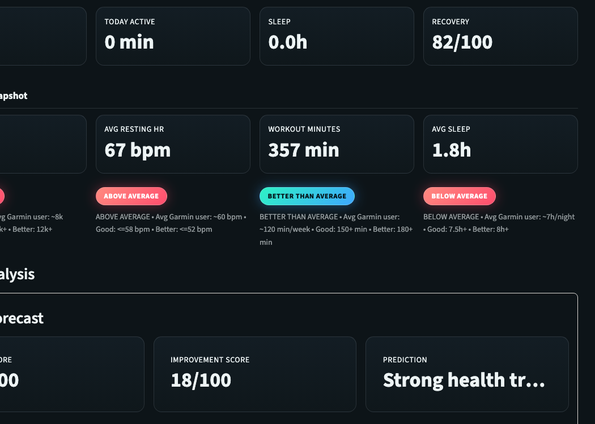

# Garmin Dashboard

A local-first Garmin dashboard built with Python, Streamlit, and SQLite.

This project syncs Garmin data into a local database and renders health, sleep, workout, and recovery insights in a clean dashboard view. It is designed to avoid repeated Garmin API calls during normal dashboard use by storing the data locally and reading from SQLite.

## Features

- local SQLite storage for Garmin metrics
- daily steps and resting heart rate tracking
- workout summaries and activity trends
- sleep and recovery data visualization
- dashboard-first experience using Streamlit
- modular structure for future health metrics and chart additions

## Quick start

```bash
git clone https://github.com/KANSHUMAN42/Garmin-Dashboard.git
cd Garmin-Dashboard
python -m venv .venv
source .venv/bin/activate
pip install -r requirements.txt
```

## Run the dashboard

From the repo root:

```bash
streamlit run app.py
```

This will start the dashboard locally in your browser at:

```text
http://localhost:8503
```

Open the app here: http://localhost:8503

## Dashboard preview



## Refresh Garmin data locally

```bash
python sync.py
```

This syncs Garmin data into the local SQLite database so the dashboard reads from local storage instead of calling the Garmin API on each page load.

## Project structure

```text
.
├── app.py                     # app entry point
├── sync.py                    # Garmin sync script
├── README.md                  # project overview
├── requirements.txt           # Python dependencies
├── LICENSE                    # MIT license
├── CONTRIBUTING.md            # contribution guide
├── dao/
│   ├── __init__.py
│   └── database.py            # DB schema and connection setup
├── services/
│   ├── __init__.py
│   └── data_service.py        # data loading and shaping logic
├── dashboard/
│   ├── __init__.py
│   ├── app.py                 # dashboard UI layout
│   └── charts.py              # chart generation functions
└── garmin.db                  # local SQLite data store
```

## How it works

1. `sync.py` connects to Garmin and stores new data in the local SQLite database.
2. `dao/database.py` owns the database schema and connection.
3. `services/data_service.py` loads the relevant tables and prepares dashboard data.
4. `dashboard/app.py` renders the dashboard.
5. `dashboard/charts.py` creates the visualizations.

## Local setup

```bash
python -m venv .venv
source .venv/bin/activate
pip install -r requirements.txt
```

## Garmin login and sync

To fetch fresh Garmin data, run:

```bash
python sync.py
```

If you have not logged in before, the script will ask for Garmin credentials in the terminal. You can also provide them in the environment:

```bash
export GARMIN_EMAIL="your_email@example.com"
export GARMIN_PASSWORD="your_password"
```

Then run:

```bash
python sync.py
```

## Run the dashboard

```bash
streamlit run app.py
```

## Why this architecture

This project separates responsibilities into layers:

- DAO layer: database access and schema management
- Service layer: data preparation and local queries
- Dashboard layer: UI and charts

That keeps the app easier to extend as you add more health, training, and recovery metrics.

## Contributing

Contributions are welcome. Please read [CONTRIBUTING.md](CONTRIBUTING.md) before opening a pull request.

## License

This project is licensed under the [MIT License](LICENSE).
